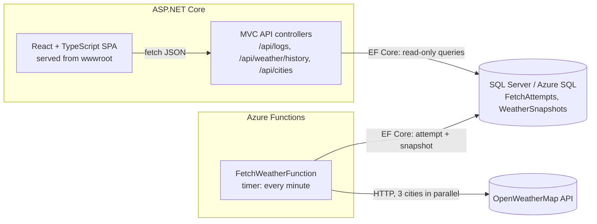

# weather-monitor

Every minute an Azure Function fetches the current weather for **London, Rome and Riga** from
[OpenWeatherMap](https://openweathermap.org/current), stores the full payload and a log of every attempt in
SQL Server, and an ASP.NET Core MVC + React app shows the fetch log and a temperature chart with a date/time filter.

| Requirement | Where |
|---|---|
| Fetch London, Rome, Riga every minute | `src/WeatherMonitor.Functions/FetchWeatherFunction.cs` (timer `0 */1 * * * *`) |
| Store the full payload | `WeatherSnapshots.RawPayload` (verbatim JSON), plus extracted columns for querying |
| Store success/failure of every attempt | `FetchAttempts` table: time, city, result, HTTP status, error, duration |
| UI page with the fetch log | `/fetch-log`: filter by city and result, paging, auto-refresh |
| UI page with a chart: min/max temperature, country, city, temperature, last update time | `/temperature`: one chart for all cities, per-city cards, tooltip, table view |
| Date and time filtering of the chart | Presets (1 h, 6 h, 24 h, 7 days) and a custom from/to date-time range |
| Unit tests | 76 .NET tests (xUnit v3) and 39 front-end tests (Vitest) |

## Documentation

| Document | For |
|---|---|
| [docs/getting-started.md](docs/getting-started.md) | Setting the environment up from scratch, by hand or with an AI assistant |
| [docs/debugging-in-visual-studio.md](docs/debugging-in-visual-studio.md) | Running and debugging step by step in Visual Studio 2026 |
| [docs/architecture.md](docs/architecture.md) | Components, data model, flows, API, front end, configuration, testing |
| [docs/adr/](docs/adr/README.md) | Architecture decision records - why things are the way they are |
| [AGENTS.md](AGENTS.md) / [CLAUDE.md](CLAUDE.md) | Orientation, conventions and gotchas for contributors and AI agents |
| [.claude/skills/](.claude/skills) | Step-by-step runbooks: run locally, verify changes, manage cities, migrations, endpoints, troubleshooting |

## Architecture



The solution follows a clean / onion layering; dependencies only point inwards:

```
src/
  WeatherMonitor.Domain           Entities FetchAttempt and WeatherSnapshot, value object CurrentWeather. No dependencies.
  WeatherMonitor.Application      Use cases (ingestion, history) and the ports they need:
                                  IWeatherProvider, IFetchAttemptRepository, IFetchLogReader, IWeatherHistoryReader.
  WeatherMonitor.Infrastructure   Adapters: EF Core DbContext, migrations, repository/readers, OpenWeatherMap HTTP client.
  WeatherMonitor.Functions        Azure Functions isolated worker; the timer function only delegates to the ingestion use case.
  WeatherMonitor.Web              ASP.NET Core MVC API controllers; hosts the built React app.
  weather-monitor.client          React 19 + TypeScript + Vite, TanStack Query, Recharts.
tests/
  WeatherMonitor.*.Tests          One test project per production project.
```

### How SOLID shows up

- **Single responsibility** - the function is a thin trigger; fetching (`OpenWeatherMapClient`), orchestration
  (`WeatherIngestionService`), persistence (`FetchAttemptRepository`) and reading (`FetchLogReader`,
  `WeatherHistoryReader`) are separate classes. The read side and the write side use separate interfaces.
- **Open/closed** - cities are configuration (`Weather:Cities`); another weather provider is a new `IWeatherProvider`.
- **Liskov** - every `IWeatherProvider` reports expected failures as a `WeatherFetchResult` instead of throwing, so callers
  never depend on a particular implementation's exceptions.
- **Interface segregation** - the web app only registers what it reads (`AddWeatherHistory`, `AddPersistence`); the
  OpenWeatherMap client and its API key exist only in the function app (`AddWeatherIngestion`, `AddOpenWeatherMap`).
- **Dependency inversion** - Application defines the ports; Infrastructure implements them; hosts compose them. Time comes
  from `TimeProvider`, so tests control the clock. The React pages get the API through a context, so tests inject a fake.

## Design decisions

- **Full payload and queryable columns.** The raw JSON is stored as received; city, country, temperature, min, max and
  observation time are extracted once on write, with a covering index for the chart query, so reads never parse JSON.
- **Every attempt is logged, failures included.** Cities are fetched independently and in parallel: an invalid city,
  HTTP error, timeout or bad payload becomes a failed `FetchAttempt` with its status code and message, and the other cities
  are still stored. All attempts of a run are saved in one transaction.
- **Unambiguous cities.** A bare `q=Rome` resolves to Rome, Georgia, USA, so every configured city carries an ISO
  country code and is requested as `q=Rome,IT`. The plain name ("Rome") is what the log and the chart show.
- **Resilience.** `Microsoft.Extensions.Http.Resilience` adds retries, a circuit breaker and timeouts (10 s per attempt,
  30 s in total) so a run always finishes before the next one starts.
- **The API key never leaks.** It is sent in the query string, so the default `HttpClient` request logging (which writes
  URIs) is removed for this client and the key is redacted from any stored error message.
- **One minute vs. ten minutes.** OpenWeatherMap refreshes an observation roughly every 10 minutes, so most minutes return
  the same observation again. Every fetch is stored (as required), and the chart query uses `DISTINCT` to show each real
  observation once, keyed by its observation time (`dt`) - which is the "last update time" shown in the UI.
- **What min/max means.** `temp_min` / `temp_max` in the current weather API are the spread across stations within the
  city area at that moment, not daily extremes. The chart draws them as a band around each city's line; the city cards show
  the lowest and highest value over the selected period.
- **UTC everywhere.** Timestamps are stored and returned as UTC (`...Z`); the browser formats them in the local time zone.
- **Accessible chart.** City colours are fixed per city (not per position), from a palette validated for colour-vision
  deficiency in light and dark mode. Lines are also labelled directly, and the chart can be switched to a table.
- **Database migrations.** EF Core migrations live in Infrastructure. With `Database:ApplyMigrationsOnStartup` (on in
  development) the hosts apply them on start; EF Core takes a database lock, so both hosts can do it safely.

## Running locally

### Prerequisites

- Visual Studio 2026 with the **ASP.NET and web development** and **Azure development** workloads
  (includes .NET 10 SDK, SQL Server LocalDB, Azurite and the Azure Functions tools), or the CLI equivalents:
  [.NET 10 SDK](https://dotnet.microsoft.com/download/dotnet/10.0),
  [Azure Functions Core Tools v4](https://learn.microsoft.com/azure/azure-functions/functions-run-local),
  [Azurite](https://learn.microsoft.com/azure/storage/common/storage-use-azurite) and SQL Server LocalDB.
- Node.js 22 LTS (or newer).
- An OpenWeatherMap API key (free plan; a new key can take up to two hours to activate).

### 1. Store the API key (once)

The key is kept out of source control with [user secrets](https://learn.microsoft.com/aspnet/core/security/app-secrets):

```bash
dotnet user-secrets set "OpenWeatherMap:ApiKey" "<your-api-key>" --project src/WeatherMonitor.Functions
```

`local.settings.json` is committed on purpose: it only holds non-secret local defaults (Azurite, LocalDB).

### 2a. Visual Studio 2026

1. Open `WeatherMonitor.slnx`.
2. Pick the **Web + Functions** launch profile next to the Start button (defined in `WeatherMonitor.slnLaunch`).
3. Press **F5**. The database is created on first start; the browser opens the app, which forwards to the Vite dev server.

### 2b. Command line

```bash
npx azurite --silent --location .azurite
```

```bash
dotnet run --project src/WeatherMonitor.Functions
```

(`dotnet run` builds the isolated worker and starts the Functions host through Core Tools.)

```bash
dotnet run --project src/WeatherMonitor.Web --launch-profile https
```

Then open <https://localhost:7180>. Within a minute the fetch log shows the first three attempts. Step-by-step
instructions, verification and troubleshooting: [docs/getting-started.md](docs/getting-started.md).

## Tests

```bash
dotnet test --solution WeatherMonitor.slnx
```

```bash
cd src/weather-monitor.client && npm test
```

- **Application** - ingestion (parallel fetch, failure isolation, timing, cancellation), history grouping and summary,
  options validation, domain invariants.
- **Infrastructure** - the OpenWeatherMap client against a stubbed `HttpMessageHandler` (parsing, error mapping,
  key redaction); repository and readers against in-memory SQLite with the real EF Core model; DI composition of both hosts.
- **Web** - the real ASP.NET Core pipeline via `WebApplicationFactory`: routing, binding, validation (RFC 7807 problems)
  and JSON shape.
- **Functions** - the timer delegates to the ingestion use case.
- **Front end** - date-range rules, chart data shaping, tooltip, filters, tables and both pages against a fake API.

CI (`.github/workflows/ci.yml`) runs lint, both test suites and the builds on every push and pull request.

## API

| Method & path | Description |
|---|---|
| `GET /api/logs?page=1&pageSize=50&city=Riga&status=Failure` | Fetch attempts, newest first. `pageSize` 1-200; `status` is `Success` or `Failure`. |
| `GET /api/weather/history?from=2026-10-18T12:00:00Z&to=2026-10-19T12:00:00Z` | Per-city series plus country, latest temperature, period min/max and last update time. Range up to 31 days. |
| `GET /api/cities` | Cities that have been fetched at least once. |
| `GET /health` | Health check including the database. |

Invalid queries return `400` with an RFC 7807 `application/problem+json` body. In development the OpenAPI document is
served at `/openapi/v1.json`.

## Configuration

| Key | Used by | Purpose |
|---|---|---|
| `ConnectionStrings:WeatherDb` | Functions, Web | SQL Server connection string |
| `OpenWeatherMap:ApiKey` | Functions | API key (user secrets locally, app setting / Key Vault in Azure) |
| `OpenWeatherMap:BaseUrl` | Functions | Defaults to `https://api.openweathermap.org/` |
| `Weather:Cities` | Functions | Cities to fetch as `{ "Name": "Rome", "CountryCode": "IT" }`; London/GB, Rome/IT, Riga/LV in `appsettings.json` |
| `Database:ApplyMigrationsOnStartup` | Functions, Web | Apply EF Core migrations on start (on in development) |
