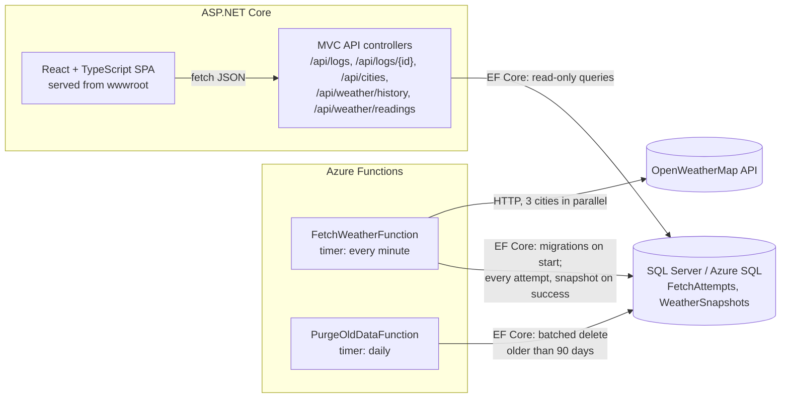
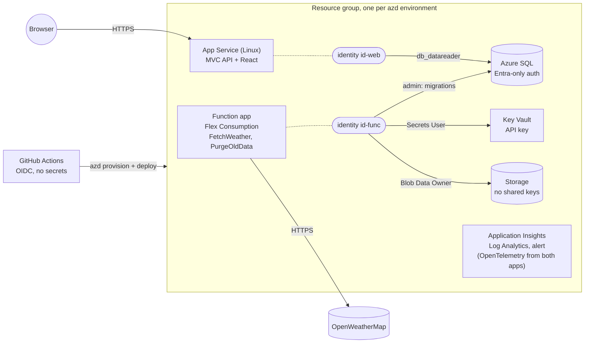

# weather-monitor

[](https://github.com/Dmitrijs-Blinkovs/weather-monitor/actions/workflows/ci.yml)

Every minute an Azure Function fetches the current weather for **London, Rome and Riga** from
[OpenWeatherMap](https://openweathermap.org/current), stores the full payload and a log of every attempt in
SQL Server, and an ASP.NET Core MVC + React app shows the fetch log and a temperature chart with a date/time filter.

## Assignment checklist

| Requirement | Where |
|---|---|
| Fetch London, Rome, Riga every minute | `src/WeatherMonitor.Functions/FetchWeatherFunction.cs` (timer `0 */1 * * * *`), cities in `appsettings.json` |
| Store the full payload | `WeatherSnapshots.RawPayload`: the response body exactly as received (all fields, not re-serialised), plus extracted columns for querying; a failed attempt keeps the body it got in `FetchAttempts.ResponseBody` (API key redacted). Both can be opened per attempt in the fetch log (**Payload** / **Details**). |
| Store success/failure attempt log | `FetchAttempts`: time, city, result, HTTP status, error, duration - for every attempt, also failed and cancelled ones |
| UI page with the fetch log | `/fetch-log`: filter by city and result, paging, auto-refresh, and per attempt a dialog with the full payload or the full error and response body (loaded on click) |
| UI page with a chart: min/max temperature, country, city, temperature, last update time | `/temperature`: one chart for all cities with a min/max band, a card per city (country, temperature, min/max, last update), tooltip, and a table of every reading (one row per city per minute, with the provider's last update time) |
| Graph contains all cities | One Recharts chart, one line and band per city |
| Date and time filtering of the graph | Presets (1 h, 6 h, 24 h, 7 days) and a custom from/to date **and time** range |
| SOLID, code quality | Layered architecture, ports and adapters, see below and [docs/architecture.md](docs/architecture.md) |
| Unit tests | 193 .NET tests (xUnit v3), 66 front-end unit/component tests (Vitest), 21 browser tests (Playwright) |
| Publish on GitHub | This repository; CI on every push ([.github/workflows/ci.yml](.github/workflows/ci.yml)) |

| Must use | How |
|---|---|
| Azure Function (cloud/local) | .NET 10 isolated worker, timer trigger; runs locally with Core Tools + Azurite, and is ready for Azure (Flex Consumption, `azd up`) - see [Azure](#azure) |
| ASP.NET Core MVC | MVC controllers (`Controllers/`, `[ApiController]` on `ControllerBase`) with model binding and validation; the "view" layer is the React app the same ASP.NET Core app serves ([ADR 0007](docs/adr/0007-spa-hosted-by-aspnet-core.md)) |
| C# | All backend code, .NET 10, nullable enabled, warnings as errors |
| TypeScript, React | React 19 + TypeScript (strict) + Vite in `src/weather-monitor.client` |
| Entity Framework Core | EF Core 10: `WeatherDbContext`, configurations, migrations, LINQ readers |
| SQL | SQL Server (LocalDB locally, Azure SQL in Azure) |

## Documentation

| Document | For |
|---|---|
| [docs/getting-started.md](docs/getting-started.md) | Setting the environment up from scratch, by hand or with an AI assistant |
| [docs/debugging-in-visual-studio.md](docs/debugging-in-visual-studio.md) | Running and debugging step by step in Visual Studio 2026 |
| [docs/deployment.md](docs/deployment.md) | Azure: what gets created, deploying with `azd` and GitHub Actions (OIDC), operations, extending, hardening |
| [docs/security.md](docs/security.md) | Threat model, OWASP Top 10 / API Top 10 / CI/CD Top 10 mapping, accepted risks |
| [docs/performance.md](docs/performance.md) | Load test: a month and 90 days of data, concurrency, the UI and the retention purge, with the scripts to repeat it |
| [docs/architecture.md](docs/architecture.md) | Components, data model, flows, API, front end, configuration, testing |
| [docs/adr/](docs/adr/README.md) | Architecture decision records - why things are the way they are |
| [AGENTS.md](AGENTS.md) / [CLAUDE.md](CLAUDE.md) | Orientation, conventions and pitfalls for contributors and AI agents |
| [.claude/skills/](.claude/skills) | Step-by-step runbooks: run locally, verify changes, manage cities, migrations, endpoints, troubleshooting, deployment |

## Architecture



The solution follows a clean / onion layering; dependencies only point inwards:

```
src/
  WeatherMonitor.Domain           Entities FetchAttempt and WeatherSnapshot, value object CurrentWeather. No dependencies.
  WeatherMonitor.Application      Use cases (ingestion, history, retention) and the ports they need:
                                  IWeatherProvider, IFetchAttemptRepository, IFetchLogReader, IWeatherHistoryReader,
                                  IWeatherReadingsReader.
  WeatherMonitor.Infrastructure   Adapters: EF Core DbContext, migrations, repository/readers, OpenWeatherMap HTTP client.
  WeatherMonitor.Functions        Azure Functions isolated worker; thin timer functions for ingestion and retention.
  WeatherMonitor.Web              ASP.NET Core MVC API controllers, security headers, rate limiting, caching, health
                                  checks; hosts the built React app.
  weather-monitor.client          React 19 + TypeScript + Vite, TanStack Query, Recharts; Playwright tests in e2e/.
tests/
  WeatherMonitor.*.Tests          One test project per production project.
infra/                            Bicep templates for Azure (azure.yaml drives them with the Azure Developer CLI).
```

### How SOLID shows up

- **Single responsibility** - the function is a thin trigger; fetching (`OpenWeatherMapClient`), orchestration
  (`WeatherIngestionService`), persistence (`FetchAttemptRepository`) and reading (`FetchLogReader`,
  `WeatherHistoryReader`, `WeatherReadingsReader`) are separate classes. The read side and the write side use separate interfaces.
- **Open/closed** - cities are configuration (`Weather:Cities`); another weather provider is a new `IWeatherProvider`.
- **Liskov** - every `IWeatherProvider` reports expected failures as a `WeatherFetchResult` instead of throwing, so callers
  never depend on a particular implementation's exceptions.
- **Interface segregation** - consumers depend on narrow ports (the API only on `IFetchLogReader`,
  `IWeatherHistoryService` and `IWeatherReadingsReader`); the web app never registers the OpenWeatherMap client or the ingestion use case, so it does
  not even need the API key.
- **Dependency inversion** - Application defines the ports; Infrastructure implements them; hosts compose them. Time comes
  from `TimeProvider`, so tests control the clock. The React pages get the API through a context, so tests inject a fake.

## Design decisions

- **Full payload and queryable columns.** The raw JSON is stored as received; city, country, temperature, min, max and
  observation time are extracted once on write, with a covering index for the chart query, so reads never parse JSON.
- **Every attempt is logged, failures included.** Cities are fetched independently and in parallel: an invalid city,
  HTTP error, timeout or bad payload becomes a failed `FetchAttempt` with its status code and message, and the other cities
  are still stored. All attempts of a run are saved in one transaction; even a cancelled run (host shutdown, function
  timeout) stores its finished cities and logs the unfinished ones as failures.
- **Unambiguous cities.** A bare `q=Rome` resolves to Rome, Georgia, USA, so every configured city carries an ISO
  country code and is requested as `q=Rome,IT`. The plain name ("Rome") is what the log and the chart show.
- **Resilience.** `Microsoft.Extensions.Http.Resilience` adds retries, a circuit breaker and timeouts (10 s per attempt,
  30 s in total per city); the Functions `functionTimeout` of 55 s bounds a whole run below the one-minute schedule.
- **The API key never leaks.** It is sent in the query string, so the default `HttpClient` request logging (which writes
  URIs) is removed for this client, provider error messages are redacted, and unexpected exception texts are logged but
  never stored.
- **One minute vs. ten minutes.** OpenWeatherMap refreshes an observation roughly every 10 minutes, so most minutes return
  the same observation again. Every fetch is stored (as required), and the chart shows each real observation once,
  keyed by its observation time (`dt`) - which is the "last update time" shown in the UI.
- **What min/max means.** `temp_min` / `temp_max` in the current weather API are the spread across stations within the
  city area at that moment, not daily extremes. The chart draws them as a band around each city's line; the city cards show
  the lowest and highest value over the selected period.
- **UTC everywhere, English everywhere.** Timestamps are stored and returned as UTC (`...Z`); the browser shows them in
  the viewer's time zone, always formatted in English.
- **Accessible chart.** City colours are fixed per city (not per position), from a palette validated for colour-vision
  deficiency in light and dark mode. Lines are also labelled directly, the chart can be switched to a table, and both
  pages pass axe-core WCAG 2 A/AA checks.
- **Database migrations.** EF Core migrations live in Infrastructure. With `Database:ApplyMigrationsOnStartup` the hosts
  apply them before they start serving (EF Core takes a database lock, so both hosts can do it safely); a test fails if the
  model changes without a migration, and CI applies and rolls back every migration on a real SQL Server.
- **Bounded growth.** A daily function deletes history older than 90 days in batches (`Retention:Days`,
  [ADR 0014](docs/adr/0014-data-retention.md)); without it the database would grow by ~8,600 rows a day forever.
- **Observable, including "silent" failures.** Expected failures are values, so a run in which every city fails is still
  a successful invocation. OpenTelemetry metrics (`weather.fetch.attempts` per city and outcome), traces of every run, a
  `/health` check that turns `Degraded` without a successful fetch in 10 minutes, and an Azure alert after 15 minutes
  without data make that visible ([ADR 0016](docs/adr/0016-observability.md)).
- **Secure by default.** Strict CSP and security headers on every response, HSTS, per-client rate limiting plus a global
  concurrency limit, output caching, caps on every query parameter, a 64 KB cap and plausibility checks on provider
  responses, one managed identity per app with read-only database access for the web app, and a deployment pipeline whose
  build job never sees a credential. Mapping to the OWASP Top 10 lists: [docs/security.md](docs/security.md).

## Azure

**Deployment-ready, not deployed.** The assignment allows the function to run locally, and that is how this submission
runs. Everything needed for Azure is in the repository and checked by CI on every push; one `azd up` creates and deploys
the whole environment. Details, operations and hardening: [docs/deployment.md](docs/deployment.md).



| Area | What is in place | Read |
|---|---|---|
| Hosting | Functions on **Flex Consumption** (.NET 10 isolated, scale to zero), Web on **App Service Linux**, **Azure SQL** Basic; about 19 USD/month | [ADR 0011](docs/adr/0011-azure-hosting-and-identity.md) |
| Identity and secrets | No password or key anywhere: **one managed identity per app** with least privilege (the web app can only read the database), **Entra-only SQL**, the API key as a **Key Vault reference**, identity-based Storage with shared keys disabled | [ADR 0015](docs/adr/0015-least-privilege-identities.md) |
| Infrastructure as code | **Bicep + Azure Developer CLI**, strict linter rules ([bicepconfig.json](infra/bicepconfig.json)) and current API versions, compiled in CI | [infra/](infra), [azure.yaml](azure.yaml) |
| Delivery | GitHub Actions with **OpenID Connect**: a build job without credentials, a deploy job behind the protected `production` environment, only CI-green pushes to `main`, a `/health` smoke test | [ADR 0012](docs/adr/0012-ci-cd-with-github-actions.md) |
| Observability | **OpenTelemetry** to Application Insights (logs, traces, metrics), ingestion metrics, a data-freshness health check, an **alert** after 15 minutes without data | [ADR 0016](docs/adr/0016-observability.md) |
| Security | HTTPS and TLS 1.3, FTP and basic-auth publishing off, the function closed to inbound traffic, Key Vault and SQL audit logs; private endpoints, purge protection and Defender listed as next steps | [docs/security.md](docs/security.md) |

**Checked without a subscription:** the templates compile with the strict linter (CI); every migration is applied, rolled
back and re-applied on SQL Server 2022 (CI); both hosts' telemetry export was checked against a local fake Application
Insights endpoint; the read-only database grant (T-SQL) was syntax-checked on SQL Server.

**From zero to running** (Owner on a subscription; the key is set by you, never committed):

```bash
azd auth login
azd env new weather-prod
azd env set AZURE_SUBSCRIPTION_ID <subscription-id>
azd env set AZURE_LOCATION northeurope
azd env set OPENWEATHERMAP_API_KEY <your-api-key>
azd up
```

**Extending it:** a staging environment is `azd env new weather-staging`; continuous deployment is `azd pipeline config`
plus the steps in [docs/deployment.md](docs/deployment.md#continuous-deployment-from-github); more cities are app settings
(`Weather__Cities__3__Name`, `...__CountryCode`); a new secret is a Key Vault secret, a reference and a role for the one
identity that needs it; private networking, alerts and scaling are listed under
[Extending in Azure](docs/deployment.md#extending-in-azure).

## Running locally

### Prerequisites

- Visual Studio 2026 with the **ASP.NET and web development** and **Azure development** workloads
  (includes .NET 10 SDK, SQL Server LocalDB, Azurite and the Azure Functions tools), or the CLI equivalents:
  [.NET 10 SDK](https://dotnet.microsoft.com/download/dotnet/10.0),
  [Azure Functions Core Tools v4](https://learn.microsoft.com/azure/azure-functions/functions-run-local),
  [Azurite](https://learn.microsoft.com/azure/storage/common/storage-use-azurite) and SQL Server LocalDB.
- Node.js 22 LTS (or newer).
- An OpenWeatherMap API key (free plan; a new key can take up to two hours to activate).

### 1. Store the API key (once)

The key is kept out of source control with [user secrets](https://learn.microsoft.com/aspnet/core/security/app-secrets):

```bash
dotnet user-secrets set "OpenWeatherMap:ApiKey" "<your-api-key>" --project src/WeatherMonitor.Functions
```

`local.settings.json` is committed on purpose: it only holds non-secret local defaults (Azurite, LocalDB).

### 2a. Visual Studio 2026

1. Open `WeatherMonitor.slnx`.
2. Pick the **Web + Functions** launch profile next to the Start button (defined in `WeatherMonitor.slnLaunch`).
3. Press **F5**. The database is created on first start; the browser opens the app, which forwards to the Vite dev server.

Step-by-step guide with breakpoints and troubleshooting: [docs/debugging-in-visual-studio.md](docs/debugging-in-visual-studio.md).

### 2b. Command line

```bash
npx azurite --silent --location .azurite
```

```bash
dotnet run --project src/WeatherMonitor.Functions
```

```bash
dotnet run --project src/WeatherMonitor.Web --launch-profile https
```

Then open <https://localhost:7180>. Within a minute the fetch log shows the first three attempts. Step-by-step
instructions, verification and troubleshooting: [docs/getting-started.md](docs/getting-started.md).

## Tests

```bash
dotnet test --solution WeatherMonitor.slnx
```

```bash
cd src/weather-monitor.client && npm test
```

```bash
cd src/weather-monitor.client && npm run test:e2e:install && npm run test:e2e
```

- **Application** - ingestion (parallel fetch, failure isolation, cancellation, timing, country codes, metrics), history
  grouping and summary, retention batches, options validation, domain invariants (attempts, observations, query
  limits), error-text sanitising, and the dependency rule between the layers.
- **Infrastructure** - the OpenWeatherMap client against a stubbed `HttpMessageHandler` (parsing, content type,
  plausibility, error mapping, timeouts, key redaction); repository (including batched deletes) and readers against
  in-memory SQLite with the real EF Core model; migrations in sync with the model; DI composition of both hosts.
- **Web** - the real ASP.NET Core pipeline via `WebApplicationFactory`: routing, binding, validation (RFC 7807 problems),
  JSON shape, SPA fallback vs. API 404/405, security headers (also on errors), rate limiting, health endpoints, output
  caching and compression.
- **Functions** - timer bindings (every minute, daily purge), shipped configuration, delegation to the use cases.
- **Front end (Vitest)** - date-range rules, formatting, chart data shaping and downsampling, tooltip, filters, tables,
  paging limits, the error boundary and both pages against a fake API.
- **Browser (Playwright)** - both pages in Chromium against the production build with a mocked API: chart with all
  cities, tooltip, presets and custom date/time range (time-zone conversion), readings table and its paging, fetch log filters and paging,
  error state, English UI in a Latvian browser, axe-core accessibility in light and dark mode, no CSP violations.

## CI/CD

- **CI** ([ci.yml](.github/workflows/ci.yml)) on every push and pull request: .NET build (high/critical NuGet
  advisories fail it) and tests with coverage summary, `npm audit`, front-end lint/tests/coverage/build, Playwright
  browser tests, Bicep compile and lint, and all migrations applied and rolled back on SQL Server 2022.
- **CD** ([deploy.yml](.github/workflows/deploy.yml)) after a green CI run on `main` once Azure is configured: a build job
  without credentials packages both apps; the deploy job (OpenID Connect, `production` environment with approval)
  provisions `infra/`, deploys exactly those packages and requires `/health` to report `Healthy` - see
  [docs/deployment.md](docs/deployment.md).
- **Supply chain:** actions pinned to commit SHAs, lockfiles and central package versions, Dependabot for NuGet, npm and
  GitHub Actions with a 3-day cooldown.

## API

| Method & path | Description |
|---|---|
| `GET /api/logs?page=1&pageSize=50&city=Riga&status=Failure` | Fetch attempts, newest first: time, city, result, HTTP status, duration. `page` 1-1,000, `pageSize` 1-200; `status` is `Success` or `Failure`. |
| `GET /api/logs/{id}` | One attempt with its full `errorMessage` and `responseBody`: the full provider payload of a success, the body of a failure (API key redacted), `null` when no response arrived; `404` when unknown or purged. |
| `GET /api/weather/history?from=2026-10-18T12:00:00Z&to=2026-10-19T12:00:00Z` | Per-city series plus country, latest temperature, period min/max and last update time. Range up to 31 days. |
| `GET /api/weather/readings?from=2026-10-19T11:00:00Z&to=2026-10-19T12:00:00Z&page=1&pageSize=60` | Every successful fetch in the range, newest first: fetch time, city, country, temperature, min/max and the provider's last update time. Range up to 31 days, `page` 1-1,000, `pageSize` 1-200. |
| `GET /api/cities` | Cities that have been fetched at least once. |
| `GET /health/live` | Liveness: the process answers (`Healthy`). Used by the App Service health probe. |
| `GET /health` | Readiness: database reachable and a successful fetch within 10 minutes (`Healthy`), `Degraded` without recent data, `503 Unhealthy` without a database. |

Invalid queries return `400` with an RFC 7807 `application/problem+json` body; unknown API routes return `404`, a wrong
HTTP method `405`, more than `RateLimiting:PermitsPerMinute` requests per client `429` with `Retry-After`. Responses are
cached briefly on the server (history 60 s, log 10 s, cities 5 min). In development the OpenAPI document is served at
`/openapi/v1.json`.

## Configuration

| Key | Used by | Purpose |
|---|---|---|
| `ConnectionStrings:WeatherDb` | Functions, Web | SQL Server connection string |
| `OpenWeatherMap:ApiKey` | Functions | API key (user secrets locally, Key Vault reference in Azure) |
| `OpenWeatherMap:BaseUrl` | Functions | Defaults to `https://api.openweathermap.org/` |
| `Weather:Cities` | Functions | Cities to fetch as `{ "Name": "Rome", "CountryCode": "IT" }`; London/GB, Rome/IT, Riga/LV in `appsettings.json` |
| `Database:ApplyMigrationsOnStartup` | Functions, Web | Apply EF Core migrations on start (on in development; in Azure on for the function only) |
| `Database:ReadOnlyIdentity:Name` / `:ClientId` | Functions | Managed identity that gets `db_datareader` after migrating (the web app's identity in Azure); unset locally |
| `Retention:Days` / `Retention:BatchSize` | Functions | Keep history this many days (90; `0` disables the purge), delete in batches of 5,000 |
| `RateLimiting:PermitsPerMinute` | Web | Requests per client and minute on `/api/*` and `/health` (120) |
| `APPLICATIONINSIGHTS_CONNECTION_STRING` | Functions, Web | Enables the OpenTelemetry export to Application Insights; nothing is exported without it |
