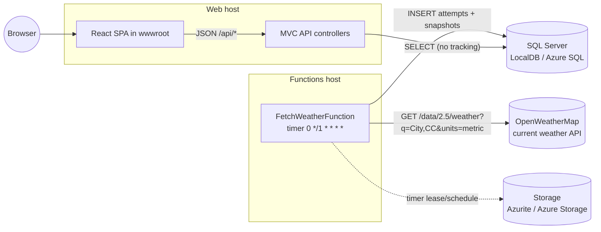
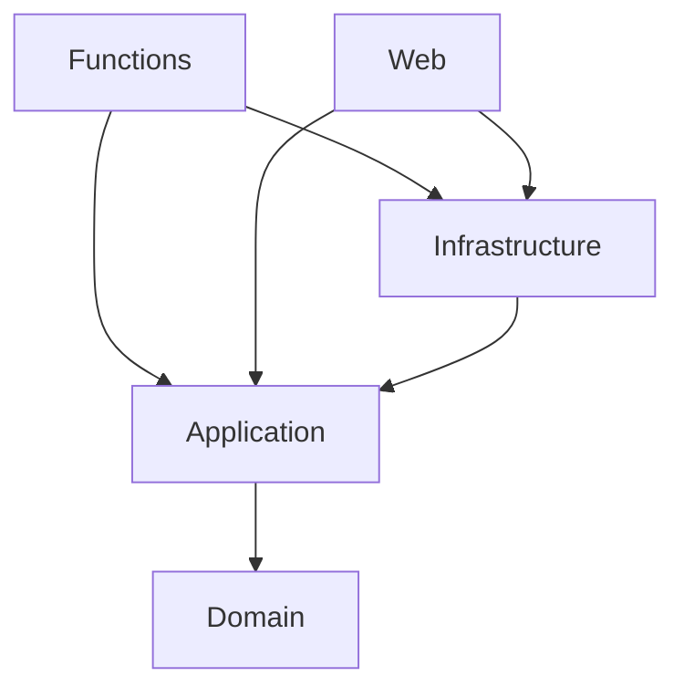
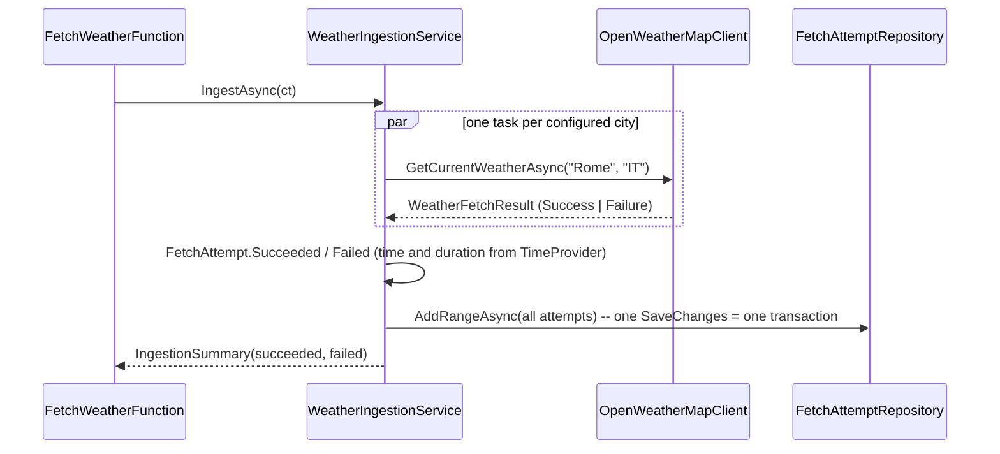

# Architecture

This document describes how Weather Monitor is built and why, at the level needed to change it safely. Decisions with
alternatives are recorded separately as ADRs in [docs/adr](adr/README.md).

## 1. Context



Two independently deployable hosts share one database and the inner libraries:

| Host | Project | Responsibility | Talks to |
|---|---|---|---|
| Functions (isolated worker, .NET 10) | `WeatherMonitor.Functions` | Fetch and store, once a minute | OpenWeatherMap, SQL, Storage (timer bookkeeping) |
| Web (ASP.NET Core MVC) | `WeatherMonitor.Web` | Read API + serve the SPA | SQL |

## 2. Layers and dependencies



| Layer | Contains | Depends on |
|---|---|---|
| Domain | `FetchAttempt`, `WeatherSnapshot`, `CurrentWeather`; invariants (UTC, lengths, truncation) | nothing |
| Application | Use cases (`WeatherIngestionService`, `WeatherHistoryService`), ports (`IWeatherProvider`, `IFetchAttemptRepository`, `IFetchLogReader`, `IWeatherHistoryReader`), DTOs, options, DI extensions | Domain, `Microsoft.Extensions.*` abstractions |
| Infrastructure | EF Core (`WeatherDbContext`, configurations, migrations, repository, readers), `OpenWeatherMapClient`, DI extensions, migration hosted service | Application, EF Core SQL Server, Http.Resilience |
| Hosts | Composition only (`Program.cs`), the timer function, MVC controllers and request models | everything above |

Rules that keep it this way:
- Ports are defined where they are *used* (Application), implemented where the technology lives (Infrastructure).
- Hosts register only what they need: Web never registers the OpenWeatherMap client, so it never needs the API key.
- Read side (`*Reader`) and write side (`*Repository`) are separate interfaces (CQRS-lite): reads project straight to
  DTOs with `AsNoTracking()`, writes go through the aggregate.

## 3. Domain model and invariants

`FetchAttempt` is the aggregate root. A successful attempt owns exactly one `WeatherSnapshot`; a failed one has none.

| Rule | Where enforced |
|---|---|
| City is required, at most 100 characters | `FetchAttempt` constructor |
| Timestamps are UTC; `Kind=Unspecified` is rejected, `Local` is converted | `FetchAttempt.EnsureUtc` |
| Duration is non-negative, stored as whole milliseconds | `FetchAttempt` constructor |
| Error messages are truncated to 2000 characters | `FetchAttempt.Failed` |
| A snapshot copies the attempt's city and fetch time; raw payload is required | `WeatherSnapshot` constructor |
| Entities are created only through factories (`Succeeded` / `Failed`); setters are private | both entities |

## 4. Data model

```
FetchAttempts                                   WeatherSnapshots
---------------------------------------------   ----------------------------------------------------
Id              bigint identity  PK             Id              bigint identity  PK
City            nvarchar(100)                   FetchAttemptId  bigint  FK -> FetchAttempts(Id), unique, cascade
AttemptedAtUtc  datetime2                       City            nvarchar(100)
IsSuccess       bit                             Country         nvarchar(8)
HttpStatusCode  int null                        Temperature     float      (deg C)
ErrorMessage    nvarchar(2000) null             TemperatureMin  float      (deg C)
DurationMs      int                             TemperatureMax  float      (deg C)
                                                ObservedAtUtc   datetime2  (provider "dt" = last update time)
IX (AttemptedAtUtc)                             FetchedAtUtc    datetime2
IX (City, AttemptedAtUtc)                       RawPayload      nvarchar(max)  (verbatim JSON)

                                                IX (ObservedAtUtc, City) INCLUDE (Country, Temperature, TemperatureMin, TemperatureMax)
```

- Every fetch is stored (one row per city per minute), as the assignment requires.
- The chart's covering index lets the history query run without touching `RawPayload`.
- Schema changes go through EF Core migrations in `Infrastructure/Persistence/Migrations`
  (see `.claude/skills/add-ef-migration`). Hosts apply them on start when `Database:ApplyMigrationsOnStartup=true`;
  EF Core 9+ takes a database lock, so both hosts can do so concurrently.

## 5. Ingestion flow (write side)



Failure handling:

| Failure | Result |
|---|---|
| HTTP 4xx/5xx (e.g. 401 inactive key, 404 unknown city, 429 rate limit) | failed attempt with status code and the provider's `message` |
| Timeout / circuit open (resilience pipeline) | failed attempt, no status code |
| Network error | failed attempt, message with the API key redacted |
| 200 with unparsable or incomplete JSON | failed attempt with status 200 and the reason |
| Unexpected exception in the provider | caught by the service, failed attempt, logged as error |
| Cancellation (host shutdown) | run aborted, nothing stored |
| Database unavailable | the function invocation fails and the Functions runtime logs it; the next minute retries |

Resilience (`AddStandardResilienceHandler`): 10 s per attempt, 2 retries with backoff for transient errors (5xx, 408,
429, timeouts), circuit breaker, 30 s total - always shorter than the one-minute schedule. `functionTimeout` is 55 s.

## 6. Read side and API

| Endpoint | Controller -> port | Notes |
|---|---|---|
| `GET /api/logs?page&pageSize&city&status` | `LogsController` -> `IFetchLogReader.GetPageAsync` | newest first; `pageSize` 1-200 (default 50); `status` `Success`/`Failure` |
| `GET /api/cities` | `CitiesController` -> `IFetchLogReader.GetCitiesAsync` | distinct cities from the log, alphabetical |
| `GET /api/weather/history?from&to` | `WeatherController` -> `IWeatherHistoryService` | ISO 8601 with offset; `from < to`; range <= 31 days |
| `GET /health` | health checks | includes a database check |
| `GET /openapi/v1.json` | OpenAPI (development only) | |
| `/api/*` (unknown) | minimal endpoint | `404` problem details - never the SPA |
| anything else | `MapFallbackToFile("index.html")` | client-side routes of the SPA |

History query: `SELECT DISTINCT City, Country, Temperature, TemperatureMin, TemperatureMax, ObservedAtUtc` within the
range. Because the provider refreshes an observation about every 10 minutes, the minute-by-minute duplicates collapse
into one point per real observation. `WeatherHistoryService` then groups by city, orders by observation time and
computes the card summary: latest temperature and country, lowest `temp_min`, highest `temp_max`, last update time.

Validation lives in request models (`FetchLogRequest`, `WeatherHistoryRequest : IValidatableObject`) and returns
`400 application/problem+json` through `[ApiController]`. The range rule is shared with the service
(`WeatherHistoryRules`), which also guards itself.

JSON: camelCase, enums as strings, timestamps as UTC with `Z`.

## 7. Front end

```
src/
  main.tsx, App.tsx            Router (/temperature, /fetch-log), QueryClient, lazy-loaded pages
  api/                         types.ts (mirrors DTOs), http.ts (fetch + problem details), weatherApi.ts, WeatherApiContext.ts
  features/chart/              ChartPage, DateRangeFilter, CitySummaryCards, TemperatureChart, WeatherTooltip,
                               ObservationsTable, chartData.ts (pure data shaping)
  features/fetch-log/          FetchLogPage, FetchLogTable, Pagination
  lib/                         dateRange.ts (presets, validation, datetime-local), format.ts, seriesColors.ts
  components/                  PageHeader, ErrorNotice, StatusBadge
  test/                        setup.ts, fixtures.ts, renderWithProviders.tsx
```

- **Data:** TanStack Query. Rolling presets (1 h, 6 h, 24 h, 7 d) are re-evaluated against "now" and refetched every
  60 s; a custom from/to range is fixed. The log refreshes every 30 s. Previous data stays visible (dimmed) while a new
  filter loads.
- **Chart:** Recharts `ComposedChart`. Series are merged into one row per observation time (`toChartRows`); lines
  bridge gaps with `connectNulls`. The tooltip shows, for every city, the observation that was current at the hovered
  time (`pointAt`, binary search), not only cities observed exactly then. Ticks are spread over the whole selected
  range (`timeTicks`). The min/max band can be hidden; the same data is available as a table.
- **Colour:** fixed categorical slots validated for colour-vision deficiency (light and dark), assigned per city from the
  full city list, so filtering never repaints a city. Lines carry direct labels; text uses ink tokens only.
- **Dev serving:** `npm run dev` (Vite, port 5173) is started by the ASP.NET Core SPA proxy; Vite proxies `/api` and
  `/health` to the backend. On publish, the `.esproj` builds the app and its `dist` is copied into `wwwroot`.

## 8. Configuration

| Key | Host | Default / source |
|---|---|---|
| `ConnectionStrings:WeatherDb` | both | LocalDB in `appsettings.Development.json` (Web) and `local.settings.json` (Functions) |
| `Database:ApplyMigrationsOnStartup` | both | `true` in development, `false` otherwise |
| `Weather:Cities` (`[{ Name, CountryCode }]`) | Functions | London/GB, Rome/IT, Riga/LV in `appsettings.json` |
| `OpenWeatherMap:ApiKey` | Functions | user secrets locally; app setting / Key Vault in Azure. Required (validated on start) |
| `OpenWeatherMap:BaseUrl` | Functions | `https://api.openweathermap.org/` |
| `AzureWebJobsStorage` | Functions | `UseDevelopmentStorage=true` (Azurite) locally |

Configuration is validated at startup (`ValidateOnStart`): a missing key or an invalid city list stops the host with a
message that says what to set.

## 9. Testing strategy

| Project | What it proves | How |
|---|---|---|
| Application.Tests | domain invariants; ingestion (parallel, isolation of failures, timing, cancellation, country codes); history grouping/summary; options validation | pure unit tests, NSubstitute, `FakeTimeProvider` |
| Infrastructure.Tests | OpenWeatherMap request/parse/error mapping/redaction; repository and readers incl. `DISTINCT`, paging, filters, UTC round-trip; DI graphs of both hosts | stub `HttpMessageHandler`; in-memory SQLite with the real model; `ValidateOnBuild` |
| Web.Tests | routing, binding, validation (problem details), JSON shape, SPA fallback vs. API 404 | `WebApplicationFactory` with substituted ports |
| Functions.Tests | the trigger delegates and propagates failures; schedule | unit |
| client (Vitest) | date-range rules, chart shaping, tooltip, filters, tables, both pages against a fake API | Testing Library, jsdom |

Nothing in the test suite needs SQL Server, Azurite, network access or an API key.

## 10. Deployment (planned)

Not set up yet. The intended Azure shape: Functions on the Flex Consumption plan, Web on App Service (Linux), Azure SQL
(Basic tier - a database written every minute never auto-pauses, so the serverless free offer would be exhausted
within days), Application Insights, secrets in app settings/Key Vault and Managed Identity for SQL.
