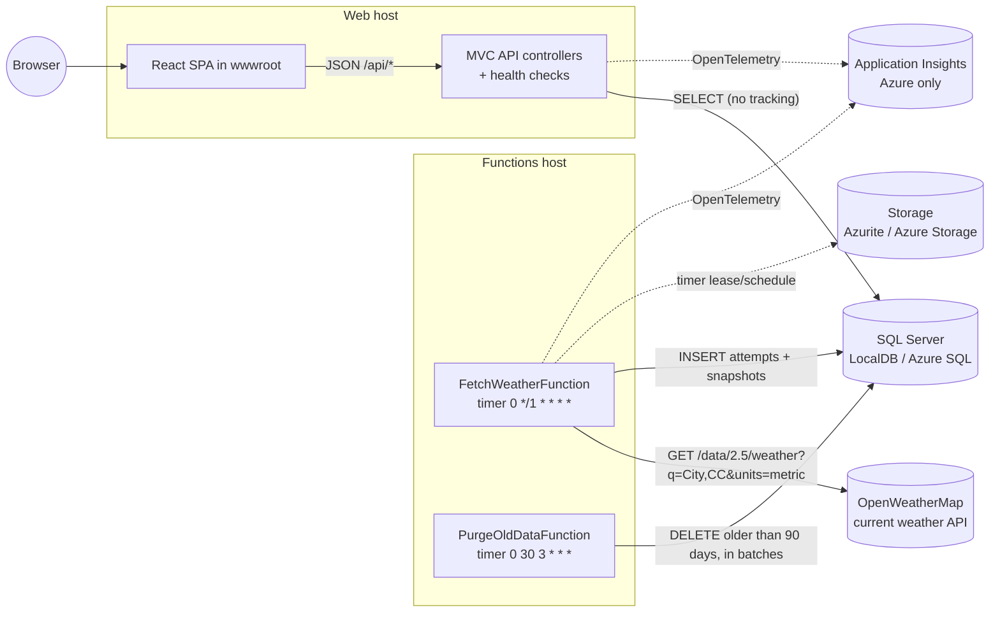
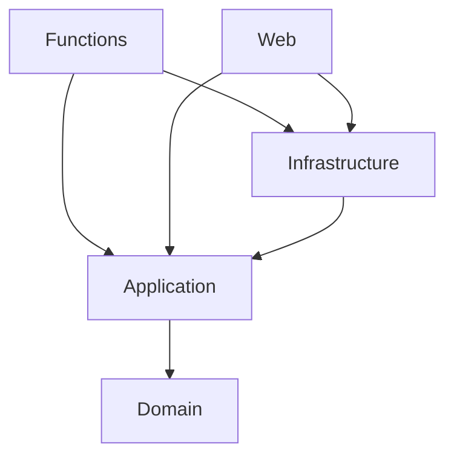
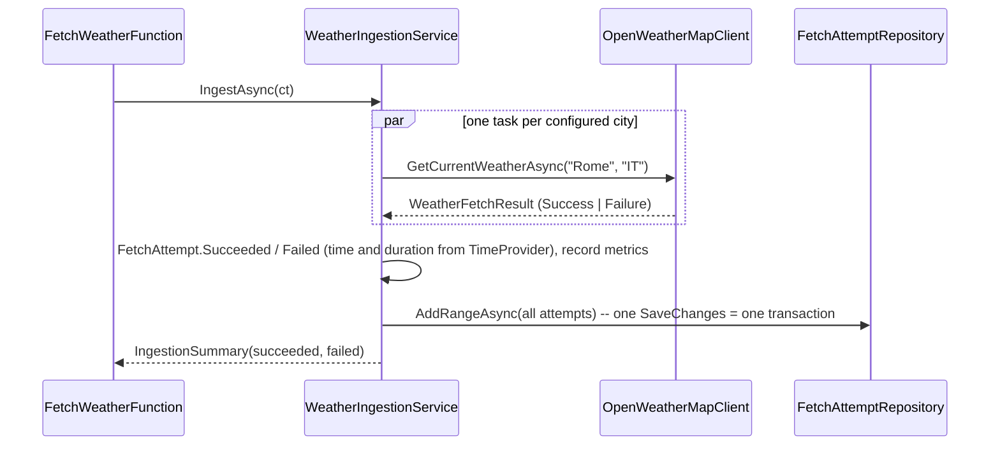

# Architecture

This document describes how Weather Monitor is built and why, at the level needed to change it safely. Decisions with
alternatives are recorded separately as ADRs in [docs/adr](adr/README.md); security controls are mapped to OWASP in
[security.md](security.md).

## 1. Context



Two independently deployable hosts share one database and the inner libraries:

| Host | Project | Responsibility | Talks to |
|---|---|---|---|
| Functions (isolated worker, .NET 10) | `WeatherMonitor.Functions` | Fetch and store once a minute; purge old history once a day | OpenWeatherMap, SQL, Storage (timer bookkeeping) |
| Web (ASP.NET Core MVC) | `WeatherMonitor.Web` | Read API, health checks, serve the SPA | SQL (read-only in Azure) |

## 2. Layers and dependencies



| Layer | Contains | Depends on |
|---|---|---|
| Domain | `FetchAttempt`, `WeatherSnapshot`, `CurrentWeather`; invariants (UTC, lengths, error-text sanitising) | nothing |
| Application | Use cases (`WeatherIngestionService`, `WeatherHistoryService`, `DataRetentionService`), ports (`IWeatherProvider`, `IFetchAttemptRepository`, `IFetchLogReader`, `IWeatherHistoryReader`, `IWeatherReadingsReader`), paging limits, DTOs, options, `IngestionMetrics`, DI extensions | Domain, `Microsoft.Extensions.*` abstractions |
| Infrastructure | EF Core (`WeatherDbContext`, configurations, migrations, repository, readers), `OpenWeatherMapClient`, health checks, migration hosted service, DI extensions | Application, EF Core SQL Server, Http.Resilience |
| Hosts | Composition only (`Program.cs`), the timer functions, MVC controllers, request models, HTTP pipeline concerns (`Security/`, `Caching/`) | everything above |

Rules that keep it this way:
- Ports are defined where they are *used* (Application), implemented where the technology lives (Infrastructure).
- Hosts register only what they need: Web never registers the OpenWeatherMap client, so it never needs the API key.
- Read side (`*Reader`) and write side (`*Repository`) are separate interfaces (CQRS-lite): reads project straight to
  DTOs with `AsNoTracking()`, writes go through the aggregate.
- Hosts never touch `WeatherDbContext` directly; even the health checks are registered by Infrastructure
  (`AddPersistenceHealthChecks`).
- Business rules live in the model, not at the edges: invariants in Domain (section 3), use-case rules in Application
  (`WeatherHistoryRules`, `FetchLogQuery`). Adapters and request models only translate a violation - into a failed
  attempt or a `400` - using the same rules and constants.
- Enforced by tests: `DependencyRuleTests` (Domain references only the BCL; Application no infrastructure or host
  technology) and `ArchitectureTests` (controllers depend only on Application ports).

## 3. Domain model and invariants

`FetchAttempt` is the aggregate root. A successful attempt owns exactly one `WeatherSnapshot`; a failed one has none.

| Rule | Where enforced |
|---|---|
| City is required, at most 100 characters | `FetchAttempt` constructor |
| Timestamps are UTC; `Kind=Unspecified` is rejected, `Local` is converted | `FetchAttempt.EnsureUtc` |
| Duration is non-negative, stored as whole milliseconds | `FetchAttempt` constructor |
| Error messages: control characters replaced (no log forging), blank becomes "Unknown error", at most 2000 characters | `FetchAttempt.SanitizeErrorMessage` |
| HTTP status, when known, is 100-599; a successful attempt has none or a 2xx | `FetchAttempt` constructor, `Succeeded` |
| An observation has a two-letter ISO 3166 country code (stored upper case), finite and plausible temperatures (-100..70 deg C), min <= max, a UTC time and a raw payload of at most 64 K characters (rejected, never cut) | `CurrentWeather` (value object; `TryCreate` returns the reason instead of throwing) |
| A snapshot copies the attempt's city and fetch time and a valid `CurrentWeather` | `WeatherSnapshot` constructor |
| Entities are created only through factories (`Succeeded` / `Failed`); setters are private | both entities |

## 4. Data model

```
FetchAttempts                                   WeatherSnapshots
---------------------------------------------   ----------------------------------------------------
Id              bigint identity  PK             Id              bigint identity  PK
City            nvarchar(100)                   FetchAttemptId  bigint  FK -> FetchAttempts(Id), unique, cascade
AttemptedAtUtc  datetime2                       City            nvarchar(100)
IsSuccess       bit                             Country         char(2)    (ISO 3166 alpha-2)
HttpStatusCode  int null                        Temperature     float      (deg C)
ErrorMessage    nvarchar(2000) null             TemperatureMin  float      (deg C)
DurationMs      int                             TemperatureMax  float      (deg C)
ResponseBody    nvarchar(max) null              ObservedAtUtc   datetime2  (provider "dt" = last update time)
  (body of a failed response, key redacted)
IX (AttemptedAtUtc)                             FetchedAtUtc    datetime2
IX (City, AttemptedAtUtc)                       RawPayload      nvarchar(max)  (verbatim JSON)
IX (IsSuccess, AttemptedAtUtc)
                                                IX (ObservedAtUtc, City) INCLUDE (Country, Temperature, TemperatureMin, TemperatureMax)
```

- The full payload is the response body exactly as received: `WeatherSnapshots.RawPayload` for a success,
  `FetchAttempts.ResponseBody` for a failure that had a body (the API key is redacted first, because an error page of a
  proxy may echo the request URL). Neither is ever returned by the API. `nvarchar` because payloads contain non-ASCII
  text (OpenWeatherMap returns local city names with diacritics).
- Every fetch is stored (one row per city per minute), as the assignment requires: ~4,300 attempts and ~4,300
  snapshots per day for three cities.
- The chart's covering index lets the history query run without touching `RawPayload`; `(IsSuccess, AttemptedAtUtc)`
  serves the log's result filter and the data-freshness check.
- History older than `Retention:Days` (90) is deleted daily (section 6).
- Schema changes go through EF Core migrations in `Infrastructure/Persistence/Migrations`
  (see `.claude/skills/add-ef-migration`). Hosts apply them on start when `Database:ApplyMigrationsOnStartup=true`;
  EF Core 9+ takes a database lock, so both hosts can do so concurrently. In Azure only the function migrates; it then
  grants the web app's identity `db_datareader` (`Database:ReadOnlyIdentity`, idempotent T-SQL with `QUOTENAME`).

## 5. Ingestion flow (write side)



Failure handling:

| Failure | Result |
|---|---|
| HTTP 4xx/5xx (e.g. 401 inactive key, 404 unknown city, 429 rate limit) | failed attempt with status code and the provider's `message` (or the reason phrase, or "HTTP nnn"); the body is kept in `ResponseBody` |
| 200 with a content type other than `application/json` | failed attempt "Unexpected content type ..." |
| 200 with unparsable or incomplete JSON | failed attempt with status 200 and the reason; the body is kept in `ResponseBody` |
| 200 with data the domain rejects (implausible temperatures, missing country) | failed attempt with the domain's reason, e.g. "Implausible temperatures: ..." (`CurrentWeather.TryCreate`) |
| Response larger than 64 KB, network error | failed attempt "Request failed: ...", API key redacted |
| Timeout / circuit open (resilience pipeline) | failed attempt, no status code |
| Unexpected exception in the provider | caught by the service, failed attempt "Unexpected error (Type)"; the exception text is only logged |
| Cancellation (host shutdown, function timeout) | finished cities keep their result, unfinished ones become failed attempts ("Cancelled before completion"); saved with a short separate timeout, then the cancellation is reported to the runtime |
| Database unavailable or rejects the data (full, schema mismatch) | SQL retries transient errors (3 times, at most 5 s apart); then an error log "Storing N fetch attempts failed", the invocation fails (the runtime logs it too) and the next minute retries. The attempts are not counted in the metrics, so the "no weather data" alert fires |
| `dt` outside the DateTime range | failed attempt "Observation time out of range" (checked before the domain sees it) |

Resilience (`AddStandardResilienceHandler`): 10 s per attempt, 2 retries with backoff for transient errors (5xx, 408,
429, timeouts), 30 s total per city; the circuit breaker opens for 45 s when at least half of at least 6 calls within
2 minutes failed (tuned for 3 calls a minute - the defaults would never trip). The Functions `functionTimeout` of 55 s
bounds a whole run below the one-minute schedule.

## 6. Retention

`PurgeOldDataFunction` (daily at 03:30 UTC) calls `DataRetentionService.PurgeAsync`: it deletes attempts older than
`Retention:Days` (default 90; `0` disables it) in batches of `Retention:BatchSize` (5,000) with `ExecuteDeleteAsync`,
oldest first, until a batch comes back short. Snapshots go with their attempt (cascade). Short transactions keep the log
small and never block the minute-by-minute inserts for long ([ADR 0014](adr/0014-data-retention.md)).

## 7. Read side and API

| Endpoint | Controller -> port | Notes |
|---|---|---|
| `GET /api/logs?page&pageSize&city&status` | `LogsController` -> `IFetchLogReader.GetPageAsync` | newest first; `page` 1-1,000; `pageSize` 1-200 (default 50); `status` `Success`/`Failure`; cached 10 s |
| `GET /api/logs/{id}` | `LogsController` -> `IFetchLogReader.GetDetailsAsync` | one attempt plus `responseBody` (`RawPayload` of its snapshot for a success, `ResponseBody` for a failure); `404` problem when unknown or purged, also for an id that is not a positive number; cached 5 min (an attempt never changes) |
| `GET /api/cities` | `CitiesController` -> `IFetchLogReader.GetCitiesAsync` | distinct cities from the log, alphabetical; cached 5 min |
| `GET /api/weather/history?from&to` | `WeatherController` -> `IWeatherHistoryService` | ISO 8601 with offset; `from < to`; range <= 31 days; cached 60 s, varied by query |
| `GET /api/weather/readings?from&to&page&pageSize` | `WeatherController` -> `IWeatherReadingsReader.GetPageAsync` | every successful fetch, newest first; range as for history; `page` 1-1,000; `pageSize` 1-200 (default 50); cached 10 s |
| `GET /health/live` | health checks (none) | liveness: the process answers; App Service probe; not rate-limited |
| `GET /health` | health checks tagged `ready` | database reachable (`Unhealthy`/503 otherwise) and a successful fetch within 10 minutes (`Degraded` otherwise) |
| `GET /openapi/v1.json` | OpenAPI (development only) | |
| `GET/HEAD /api/*` (unknown) | minimal endpoint | `404` problem details - never the SPA; a wrong verb on a known route gets `405` |
| anything else | `MapFallbackToFile("index.html")` | client-side routes of the SPA |

History query: `SELECT DISTINCT City, Country, Temperature, TemperatureMin, TemperatureMax, ObservedAtUtc` within the
range. Because the provider refreshes an observation about every 10 minutes, the minute-by-minute duplicates collapse
into one point per real observation. `WeatherHistoryService` then groups by city, orders by observation time, keeps one
point per observation time (a revised observation with the same `dt` would otherwise appear twice) and computes the card
summary: latest temperature and country, lowest `temp_min`, highest `temp_max`, last update time.

Readings query: the opposite of the history - nothing is collapsed. Every successful attempt in the range is one row
(fetch time, city, country, temperatures and the observation's `ObservedAtUtc`), so the UI can prove that a fetch arrived
even when the provider returned the same observation as a minute before. It pages like the fetch log (below) over the
attempts' `(IsSuccess, AttemptedAtUtc)` index and then reads only that page's snapshots, never the payload.

Fetch-log and readings paging is a deferred join: `OFFSET @skip ... FETCH NEXT @take` runs over the narrow time index
(keys only), then only the rows of the page are read. Measured on 90 days of data (388,800 attempts): page 1,000 x 200 reads
~1,500 pages instead of ~640,000 with a plain OFFSET over full rows. The `COUNT(*)` for the page total (~1,750 pages)
is now the larger part of an uncached log request.

Request models (`FetchLogRequest`; `WeatherHistoryRequest` and `WeatherReadingsRequest`, both a `TimeRangeRequest :
IValidatableObject`) validate against the Application's rules and return `400 application/problem+json` through
`[ApiController]`; the rules themselves guard the use cases too: `WeatherHistoryRules` (range, used by the service and
by `WeatherReadingsQuery`) and `PageLimits` (page 1-1,000, page size 1-200, enforced by the constructors of
`FetchLogQuery` and `WeatherReadingsQuery`). `PageLimits.MaxPage` bounds `OFFSET` scans and must match `MAX_PAGE` in
the client.

JSON: camelCase, enums as strings, timestamps as UTC with `Z`.

HTTP pipeline (`Program.cs`, in this order): exception handler and status-code pages (RFC 7807), security headers
(`Security/SecurityHeaders.cs`, added in `OnStarting` so 500s and 429s carry them too: strict CSP, `nosniff`,
`frame-ancestors 'none'`, referrer and permissions policies, COOP/CORP), HSTS (1 year, outside development), HTTPS
redirection, response compression (Brotli/gzip), static assets, rate limiter (`Security/ApiRateLimiting.cs`: per-client
fixed window of `RateLimiting:PermitsPerMinute` on `/api/*` and `/health`, plus a global concurrency limit of 64 with a
queue of 128; 429 with `Retry-After`), output cache (`Caching/ApiCaching.cs`; request coalescing is off, because a
waiting request would inherit the cancellation of an aborted one). In Azure, forwarded headers are enabled
so the rate limiter partitions by the real client IP, and `AllowedHosts` is the app's host name.

## 8. Front end

```
src/
  main.tsx, App.tsx            Router (/temperature, /fetch-log), QueryClient, lazy-loaded pages, error boundary per route
  api/                         types.ts (mirrors DTOs), http.ts (fetch + problem details), weatherApi.ts, WeatherApiContext.ts
  features/chart/              ChartPage, DateRangeFilter, CitySummaryCards, TemperatureChart, WeatherTooltip,
                               ReadingsTable, chartData.ts (pure data shaping), downsample.ts (LTTB)
  features/fetch-log/          FetchLogPage, FetchLogTable, AttemptDetailsDialog
  lib/                         dateRange.ts (presets, validation, datetime-local), format.ts, seriesColors.ts
  components/                  PageHeader, ErrorNotice, StatusBadge, ErrorBoundary, Pagination
  test/                        setup.ts, fixtures.ts, renderWithProviders.tsx
```

- **Data:** TanStack Query. Rolling presets (1 h, 6 h, 24 h, 7 d) are re-evaluated against "now" and refetched every
  60 s; their `to` is rounded up to the next whole minute, so all viewers within a minute send the same URL and hit the
  server's output cache. A custom from/to range is fixed. The log and the readings table refresh every 30 s. Previous
  data stays visible (dimmed) while a new filter loads.
- **Chart:** Recharts `ComposedChart`. Series are merged into one row per observation time (`toChartRows`); lines
  bridge gaps with `connectNulls`. Each city is downsampled to at most 600 points (largest-triangle-three-buckets keeps
  peaks and troughs), so a 31-day range stays fast; the tooltip still uses every observation. The tooltip shows, for
  every city, the observation that was current at the hovered time (`pointAt`, binary search). Legend, tooltip
  rows and city cards all keep the API's alphabetical city order. Ticks are spread over the
  whole selected range (`timeTicks`). The min/max band can be hidden. "Show as table" lists every reading
  instead (one row per city and fetch, 60 per page from the server) with the fetch time and the provider's last update time, so a new fetch is
  visible even when the observation, and so the chart, did not change ([ADR 0004](adr/0004-distinct-observations-on-read.md)).
- **Attempt details:** each log row has a **Payload** (success) or **Details** (failure) button. It opens a native
  `<dialog>` (focus, Esc and backdrop handled by the browser) that only then requests `GET /api/logs/{id}`, so the
  log never transfers error texts or bodies; the result is cached for the session. JSON is indented for reading and rendered as
  text, never as HTML; **Copy** takes the body exactly as stored.
- **Paging:** both pagers (`components/Pagination.tsx`) stop at page 1,000 (`MAX_PAGE`, same cap as the API) and suggest
  filtering or a shorter period instead.
- **Errors:** an `ErrorBoundary` around the routes (reset on navigation) turns a render error into a message instead of
  a blank page; API errors show the problem details' `detail` (or `title`).
- **Colour:** fixed categorical slots validated for colour-vision deficiency (light and dark), assigned per city from the
  full city list, so filtering never repaints a city. Lines carry direct labels; text uses ink tokens only. Both pages
  pass axe-core WCAG 2 A/AA in light and dark mode (checked by the Playwright suite).
- **Language:** English only. Dates and numbers are formatted with a fixed English locale (`UI_LOCALE = 'en-GB'`,
  24-hour clock) in the viewer's time zone; the native date-time inputs follow the browser's own locale.
- **CSP:** no inline scripts or styles are needed; `vite preview` serves the same headers as the server
  (`vite.config.ts`), so the Playwright suite fails on any CSP violation.
- **Dev serving:** `npm run dev` (Vite on `127.0.0.1:5173`: IPv4 on purpose, because Node binds `localhost` to `::1`
  only, which hangs where IPv6 loopback is blocked) is started by the ASP.NET Core SPA proxy; Vite proxies `/api` and
  `/health` to the backend. On publish, the `.esproj` builds the app and its `dist` is copied into `wwwroot`.

## 9. Observability

([ADR 0016](adr/0016-observability.md))

- **OpenTelemetry in code** for both hosts; wired up and exported to Application Insights only when
  `APPLICATIONINSIGHTS_CONNECTION_STRING` is set (Azure). Locally it is off, so worker logs reach the Functions
  console as usual (with `UseFunctionsWorkerDefaults()` the host stops forwarding them). Functions: `host.json`
  `telemetryMode: OpenTelemetry`, `UseFunctionsWorkerDefaults()`, HttpClient instrumentation (query strings redacted).
  Web: `UseAzureMonitor()`.
- **Metrics** (meter `WeatherMonitor.Ingestion`), recorded once the attempts are stored: `weather.fetch.attempts`
  (counter) and `weather.fetch.duration`
  (histogram, ms), both tagged `city` and `outcome` (`success` / `failure`).
- **Health:** `/health/live` and `/health` (section 7). `DataFreshnessHealthCheck` reports `Degraded` when the newest
  successful attempt is older than 10 minutes - the case where every invocation "succeeds" but no data arrives.
- **Alert** (Azure): no `success` in the metric for 15 minutes.
- **Logs:** `[LoggerMessage]` source-generated; the OpenWeatherMap `HttpClient` has no default loggers (they would write
  the URL with the API key).

## 10. Configuration

| Key | Host | Default / source |
|---|---|---|
| `ConnectionStrings:WeatherDb` | both | LocalDB in `appsettings.Development.json` (Web) and `local.settings.json` (Functions) |
| `Database:ApplyMigrationsOnStartup` | both | `true` in development; in Azure only on the function; runs before the host starts serving (`IHostedLifecycleService.StartingAsync`) |
| `Database:ReadOnlyIdentity:Name` / `:ClientId` | Functions | unset locally; the web identity in Azure (gets `db_datareader` after migrating) |
| `Weather:Cities` (`[{ Name, CountryCode }]`) | Functions | London/GB, Rome/IT, Riga/LV in `appsettings.json` |
| `OpenWeatherMap:ApiKey` | Functions | user secrets locally; Key Vault reference in Azure. Required (validated on start) |
| `OpenWeatherMap:BaseUrl` | Functions | `https://api.openweathermap.org/`; must be an absolute https URL |
| `Retention:Days` / `Retention:BatchSize` | Functions | 90 (0 disables; at most 3,650) / 5,000 |
| `RateLimiting:PermitsPerMinute` | Web | 120 per client |
| `APPLICATIONINSIGHTS_CONNECTION_STRING` | both | unset locally; set by the Azure templates |
| `AzureWebJobsStorage` | Functions | `UseDevelopmentStorage=true` (Azurite) locally; identity-based in Azure |

Configuration is validated at startup (`ValidateOnStart`): a missing key, an invalid city list, a non-https base URL or
an out-of-range retention stops the host with a message that says what to set.

## 11. Testing strategy

| Project | What it proves | How |
|---|---|---|
| Application.Tests | domain invariants (`FetchAttempt`, `CurrentWeather`) and error-text sanitising; query and paging limits; the dependency rule; ingestion (parallel, isolation of failures, cancellation keeps finished cities, timing, country codes, no exception text stored, metrics); history grouping/summary/duplicate times; retention batches; options validation | pure unit tests, NSubstitute, `FakeTimeProvider`, `MetricCollector` |
| Infrastructure.Tests | the data-model contract (every text column has the length the domain validates, datetime2, float, char(2)); OpenWeatherMap request/parse/content type/plausibility/error mapping/timeouts/redaction/https options; repository (incl. batched delete with cascade) and readers incl. `DISTINCT`, paging, filters, UTC round-trip; migrations in sync with the model; DI graphs of both hosts | stub `HttpMessageHandler`; in-memory SQLite with the real model; `HasPendingModelChanges`; `ValidateOnBuild` |
| Web.Tests | controllers depend only on Application ports; routing, binding, validation (problem details, page and range caps), JSON shape, SPA fallback vs. API 404/405, security headers (also on 500), rate limiting (429), liveness vs. readiness, output cache and compression | `WebApplicationFactory` with substituted ports and a temporary web root |
| Functions.Tests | both timer bindings (every minute, daily; not on startup), the shipped configuration (cities, retention), delegation and failure propagation | reflection on the binding attributes; the real `appsettings.json` |
| client (Vitest) | date-range rules and rounding, English formatting, chart shaping, downsampling, tooltip, filters, the readings and log tables, the attempt-details dialog, paging cap, error boundary, both pages against a fake API | Testing Library, jsdom |
| client (Playwright) | both pages in Chromium against the production build: chart with all cities, tooltip, presets and custom ranges (time zone), readings table/paging, log filters/paging, attempt details, error state, English UI in a Latvian browser, accessibility, no CSP violations | mocked API (`page.route`), axe-core ([ADR 0013](adr/0013-browser-tests-with-playwright.md)) |

Nothing in the test suite needs SQL Server, Azurite, network access or an API key. CI also collects code coverage
(.NET: Microsoft.Testing.Platform coverage, summary on the run page; front end: Vitest v8 coverage) and, in a separate
job, applies and rolls back every migration on SQL Server 2022 in a container.

## 12. Deployment

Infrastructure as code in `infra/` (Bicep), driven by the Azure Developer CLI (`azure.yaml`) and the
`Deploy to Azure` workflow (OIDC, runs after a green CI run on `main`). Functions on Flex Consumption, Web on App Service
(Linux), Azure SQL Basic (Entra-only), Key Vault for the API key, Application Insights with an alert, and one
user-assigned managed identity per app ([ADR 0015](adr/0015-least-privilege-identities.md)). Not deployed yet - see
[deployment.md](deployment.md) and [ADR 0011](adr/0011-azure-hosting-and-identity.md).
